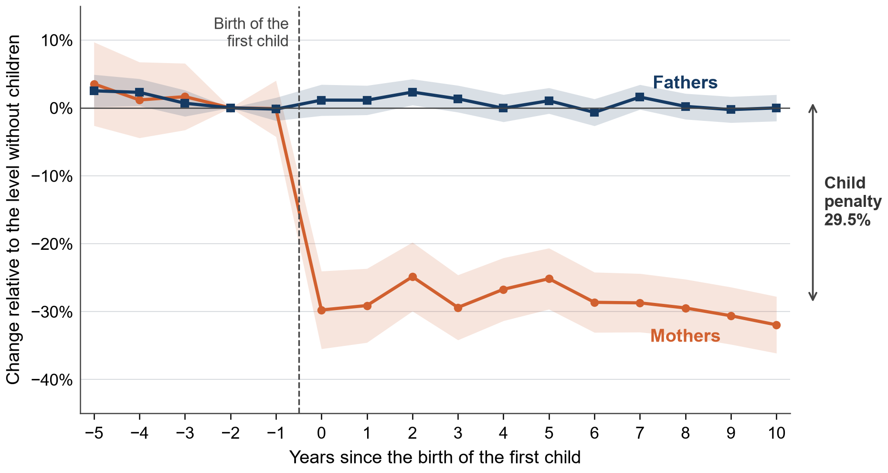

English | [Español](README.es.md)

# Motherhood and Women's Employment in Costa Rica, 2010-2025

Joseph Aarón Atencio Arias, June 2026

This repository contains the code and report of a study of how much the employment of Costa Rican women changes when they have their first child, compared with what would have happened without children and with what happens to men. It uses the sixteen National Household Surveys (ENAHO) from 2010 to 2025, with 330,255 people aged 15 to 55, and the pseudo-event study with which Kleven, Landais and Leite-Mariante (2025) measured the child penalty in 134 countries.

The report is in [`report/maternidad_empleo_costa_rica_en.pdf`](report/maternidad_empleo_costa_rica_en.pdf), with the Spanish version in [`report/maternidad_empleo_costa_rica.pdf`](report/maternidad_empleo_costa_rica.pdf). The code is in two notebooks, already executed, [`notebooks/1_base_de_datos.ipynb`](notebooks/1_base_de_datos.ipynb), which builds the dataset, and [`notebooks/2_analisis.ipynb`](notebooks/2_analisis.ipynb), which carries out the analysis. The code and its comments are in Spanish.

## Main results

With the first child, women's employment falls 28.6% relative to what it would be without children, about 20.5 percentage points, and ten years later it is still just as low. Men's employment does not change, so the child penalty in employment is 29.5% (standard error of 1.6). Mothers' working hours fall 34.7% and their formal employment 38.4%, while informal employment ends up 61.4% above its level without children after ten years.

The penalty for mothers with tertiary education (13.2%) is less than half that of mothers with secondary education or less (30.2%). Those who have their first child after age 30 seem to pay less, but within each education level the penalty is the same before and after that age. Nor did it change between 2010-2014 (29.0%) and 2020-2025 (31.0%), and it is larger in rural areas (39.5%) than in urban areas (25.6%).



Change in the employment of mothers and fathers relative to the level they would have without children. The bands are 95% confidence intervals.

## Method

The ENAHO only records each person's relationship to the household head, so children are assigned to their parents with relationship and age rules like those of IPUMS, and ambiguous cases are not assigned. The resulting share of first-time mothers is compared, age by age, with that of the Vital Statistics. The age of the oldest child places mothers and fathers in years 0 to 10 after the first birth, and the previous years are built with childless people of the same sex, age, education, marital status and area. An event study by sex, with age and year effects and standard errors clustered by household, measures how much more the mother's employment falls than the father's. The result is put through the test on men, eleven variants of the calculation, a household bootstrap and a comparison with previous studies.

## Data

The data come from the National Institute of Statistics and Censuses (INEC). The ENAHO and Vital Statistics microdata are not included, because INEC distributes them and their redistribution terms could not be confirmed, but they can be downloaded from its website. [`data/README.md`](data/README.md), in Spanish, explains which files to download and where to put them. The repository does include the INEC table of demographic indicators with the total fertility rate.

## Requirements

The results were produced with Python 3.12.10 on Windows 11 and with the package versions pinned in `requirements.txt`. Notebook 1 takes about a minute and a half and notebook 2 about four minutes, almost all of it in the bootstrap of 300 repetitions, which uses the seed 2025 to always give the same result.

## How to reproduce the results

First download the INEC microdata and put them in `data/raw/inec/`, as [`data/README.md`](data/README.md) explains. Then, from the repository folder, install the packages and run the two notebooks in order.

```bash
pip install -r requirements.txt
```

```bash
jupyter nbconvert --to notebook --execute --inplace notebooks/1_base_de_datos.ipynb notebooks/2_analisis.ipynb
```

If the microdata are in another folder, it is enough to set it in the environment variable `DATOS_INEC` or in the first cell of notebook 1. Notebook 1 saves the dataset in `data/processed/`. Notebook 2 writes the tables as CSV and the figures as PNG in `outputs/`, and it also writes the numbers in the text, the tables and the figures with which the report was compiled, in the folder `report/latex/`, which is not part of the repository. Figures, numbers and tables are written in Spanish and in English, for the two versions of the report, and the English ones go into the `en/` subfolders. Before exporting them, it checks against the data the 34 statements in the text that are not numbers, and it stops if any of them no longer holds.

## Contents

| Path | Contents |
|---|---|
| `data/` | Description of the data and INEC table of demographic indicators |
| `notebooks/1_base_de_datos.ipynb` | Reading the surveys, linking children to parents and building the analysis variables |
| `notebooks/2_analisis.ipynb` | Validation, pseudo-panel, estimates, robustness and export to the report |
| `outputs/tables/` | The full tables, as CSV |
| `outputs/figures/` | The figures of the report as PNG, and their English version in `en/` |
| `report/` | The report as PDF, in Spanish and in English |

## Mapping between the report and the code

| In the report | Section of notebook 2 | Table in `outputs/tables/` |
|---|---|---|
| Figure 1, context | 1 | `contexto` |
| Table 1, validation with the Vital Statistics | 2 | `validacion_vitales` |
| Figure 2 and Table A1, employment of mothers and fathers | 4 | `efectos_por_anio` |
| Table A2, the test on men | 5 | `prueba_emparejamiento` |
| Figure 3 and Table 2, hours, earnings and formality | 6 | `resultados_principales`, `efectos_por_anio` |
| Figure 4 and Table A4, penalty by group | 7 | `por_grupo`, `diferencias_entre_grupos` |
| Table A3, robustness, bootstrap and other studies | 8 | `solidez`, `bootstrap`, `comparacion_estudios` |

The share of children with their mother identified comes from notebook 1, in `vinculos_madre_hijo`.

## Main references

Kleven, H. (2022). *The geography of child penalties and gender norms: A pseudo-event study approach* (NBER Working Paper 30176). National Bureau of Economic Research.

Kleven, H., Landais, C. and Leite-Mariante, G. (2025). The Child Penalty Atlas. *Review of Economic Studies, 92*(5).

Marchionni, M. and Pedrazzi, J. (2025). The last hurdle? Unyielding motherhood effects in the context of declining gender inequality in Latin America. *World Development, 195*.

## How to cite

Atencio Arias, J. A. (2026). *Motherhood and women's employment in Costa Rica. Evidence from 2010 to 2025*.

The `CITATION.cff` file has the same reference for the Spanish version, and GitHub shows it in other formats under the "Cite this repository" button.
