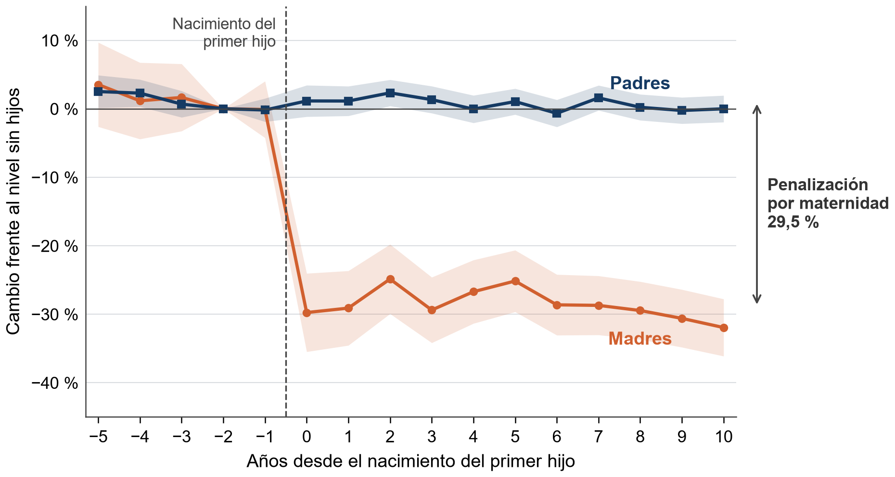

# Maternidad y empleo femenino en Costa Rica, 2010-2025

Joseph Aarón Atencio Arias, junio de 2026

Este repositorio contiene el código y el informe de un estudio sobre cuánto cambia el empleo de las mujeres costarricenses cuando tienen su primer hijo, frente a lo que habría pasado sin hijos y frente a lo que les pasa a los hombres. Usa las dieciséis Encuestas Nacionales de Hogares (ENAHO) de 2010 a 2025, con 330.255 personas de 15 a 55 años, y el estudio de pseudo-eventos con el que Kleven, Landais y Leite-Mariante (2025) midieron la penalización por maternidad en 134 países.

El informe está en [`report/maternidad_empleo_costa_rica.pdf`](report/maternidad_empleo_costa_rica.pdf). El código está en dos cuadernos ya ejecutados, [`notebooks/1_base_de_datos.ipynb`](notebooks/1_base_de_datos.ipynb), que arma la base, y [`notebooks/2_analisis.ipynb`](notebooks/2_analisis.ipynb), que hace el análisis.

## Resultados principales

Con el primer hijo, el empleo de las mujeres cae 28,6 % frente al que tendrían sin hijos, unos 20,5 puntos porcentuales, y diez años después sigue igual de bajo. El de los hombres no cambia, así que la penalización por maternidad en el empleo es de 29,5 % (error estándar de 1,6). Las horas de trabajo de las madres caen 34,7 % y su empleo formal 38,4 %, mientras que el informal termina 61,4 % por encima de su nivel sin hijos a los diez años.

La penalización de las madres con educación superior (13,2 %) es menos de la mitad que la de las madres con secundaria o menos (30,2 %). Las que tienen su primer hijo después de los 30 años parecen pagar menos, pero dentro de cada nivel educativo la penalización es la misma antes y después de esa edad. Tampoco cambió entre 2010-2014 (29,0 %) y 2020-2025 (31,0 %), y es mayor en la zona rural (39,5 %) que en la urbana (25,6 %).



Cambio en el empleo de madres y padres frente al nivel que tendrían sin hijos. Las franjas son los intervalos de confianza al 95 %.

## Summary in English

This repository contains the code and report for a pseudo-event study of first childbirth in Costa Rica (Kleven 2022; Kleven, Landais and Leite-Mariante 2025), built from the national household survey, 2010-2025. Children are linked to their parents with IPUMS-style relationship rules, validated against vital statistics. Women's employment falls 28.6% relative to the counterfactual at first birth and does not recover within ten years, while men's does not change, a child penalty of 29.5% (s.e. 1.6). Mothers shift from formal to informal work. The penalty is less than half as large for university-educated women, postponing motherhood is not associated with a smaller penalty once education is taken into account, and the penalty did not change between 2010 and 2025. The report is in Spanish.

## Método

La ENAHO solo registra el parentesco de cada persona con la jefatura del hogar, así que los hijos se asignan a sus padres con reglas de parentesco y de edad como las de IPUMS, y los casos ambiguos no se asignan. La proporción de madres primerizas que resulta se compara, edad por edad, con la de las Estadísticas Vitales. La edad del hijo mayor ubica a madres y padres en los años 0 a 10 después del primer nacimiento, y los años previos se construyen con personas sin hijos del mismo sexo, edad, educación, estado civil y zona. Un estudio de eventos por sexo, con efectos de edad y de año y errores estándar agrupados por hogar, mide cuánto más cae el empleo de la madre que el del padre. El resultado se somete a la prueba de los hombres, a once variantes del cálculo, a un bootstrap por hogares y a la comparación con los estudios previos.

## Datos

Los datos son del Instituto Nacional de Estadística y Censos (INEC). Los microdatos de la ENAHO y de las Estadísticas Vitales no se incluyen, porque los distribuye el INEC y no se pudieron confirmar sus condiciones de redistribución, pero se descargan de su sitio. [`data/README.md`](data/README.md) explica qué archivos bajar y dónde colocarlos. El repositorio sí incluye el cuadro de indicadores demográficos del INEC con la tasa global de fecundidad.

## Requisitos

Los resultados se generaron con Python 3.12.10 en Windows 11 y con las versiones de los paquetes que fija `requirements.txt`. El cuaderno 1 tarda alrededor de un minuto y medio y el cuaderno 2 unos cuatro minutos, casi todo en el bootstrap de 300 repeticiones, que usa la semilla 2025 para dar siempre el mismo resultado.

## Cómo reproducir los resultados

Primero se descargan los microdatos del INEC y se colocan en `data/raw/inec/`, como indica [`data/README.md`](data/README.md). Luego, desde la carpeta del repositorio, se instalan los paquetes y se corren los dos cuadernos en orden.

```bash
pip install -r requirements.txt
```

```bash
jupyter nbconvert --to notebook --execute --inplace notebooks/1_base_de_datos.ipynb notebooks/2_analisis.ipynb
```

Si los microdatos están en otra carpeta, basta con indicarla en la variable de entorno `DATOS_INEC` o en la primera celda del cuaderno 1. El cuaderno 1 guarda la base en `data/processed/`. El cuaderno 2 escribe las tablas en CSV y las figuras en PNG de `outputs/`, y también escribe las cifras del texto, los cuadros y las figuras con que se compiló el informe, en la carpeta `report/latex/`, que no forma parte del repositorio. Antes de exportarlos comprueba con los datos las 34 afirmaciones del texto que no son cifras, y se detiene si alguna deja de cumplirse.

## Contenido

| Ruta | Contenido |
|---|---|
| `data/` | Descripción de los datos y cuadro de indicadores demográficos del INEC |
| `notebooks/1_base_de_datos.ipynb` | Lectura de las encuestas, vínculo entre hijos y padres y variables del análisis |
| `notebooks/2_analisis.ipynb` | Validación, pseudo-panel, estimaciones, solidez y exportación al informe |
| `outputs/tables/` | Las tablas completas, en CSV |
| `outputs/figures/` | Las figuras del informe en PNG |
| `report/` | El informe en PDF |

## Correspondencia entre el informe y el código

| En el informe | Sección del cuaderno 2 | Tabla en `outputs/tables/` |
|---|---|---|
| Figura 1, contexto | 1 | `contexto` |
| Cuadro 1, validación con las Estadísticas Vitales | 2 | `validacion_vitales` |
| Figura 2 y cuadro A1, empleo de madres y padres | 4 | `efectos_por_anio` |
| Cuadro A2, la prueba de los hombres | 5 | `prueba_emparejamiento` |
| Figura 3 y cuadro 2, horas, ingresos y formalidad | 6 | `resultados_principales`, `efectos_por_anio` |
| Figura 4 y cuadro A4, penalización por grupo | 7 | `por_grupo`, `diferencias_entre_grupos` |
| Cuadro A3, solidez, bootstrap y otros estudios | 8 | `solidez`, `bootstrap`, `comparacion_estudios` |

La cifra de niños con su madre identificada sale del cuaderno 1, en `vinculos_madre_hijo`.

## Referencias principales

Kleven, H. (2022). *The geography of child penalties and gender norms: A pseudo-event study approach* (NBER Working Paper 30176). National Bureau of Economic Research.

Kleven, H., Landais, C. y Leite-Mariante, G. (2025). The Child Penalty Atlas. *Review of Economic Studies, 92*(5).

Marchionni, M. y Pedrazzi, J. (2025). The last hurdle? Unyielding motherhood effects in the context of declining gender inequality in Latin America. *World Development, 195*.

## Cómo citar

Atencio Arias, J. A. (2026). *Maternidad y empleo femenino en Costa Rica. Evidencia de 2010 a 2025*.

El archivo `CITATION.cff` tiene los mismos datos, y GitHub los muestra en otros formatos en el botón «Cite this repository».
